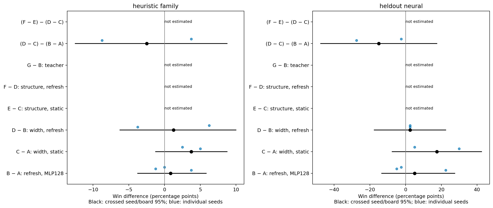

# Independent interpretation of the recovered scaling study

This post-run interpretation was added for repository publication using the saved results from 2026-11-14. No new training or simulations were run. The original [findings](findings.md), [raw final games](final-games.csv) and [paired comparisons](paired-comparisons.json) remain authoritative records; the frozen report and manifests were not changed.

The experiment completed ten fresh PPO runs at \(425{,}984\) learner transitions each. It establishes that this training setup learns to compete with a held-out historical PPO policy, but does not yet produce strong play against the adapted value-function heuristics. Sampled heuristic-family wins were \(5/240\) for MLP128 static, \(7/240\) for MLP128 refreshed, \(7/160\) for MLP512 static and \(5/160\) for MLP512 refreshed. The validation-selected policy subsequently won \(18/400=4.5\%\) on its confirmation panel.

## What the comparisons establish

Both opponent schedules included frozen neural policies from the same initial archive, alongside the same heuristic anchors. The static schedule kept that pool fixed; the refreshed schedule added the learner's own frozen snapshots. This tests refreshing an existing neural opponent pool, rather than introducing neural opponents into a heuristic-only baseline.

For MLP128, refreshing changed the primary win rate by \(+0.83\) percentage points, with a crossed seed/board \(95\%\) interval of \([-3.75,+5.83]\). Its held-out PPO improvement was inconsistent across seeds. Static MLP512 had a promising paired capacity estimate of \(+3.75\) points, but its interval \([-1.25,+8.75]\) includes zero and uses only two seed pairs. Capacity contrasts use the common seeds, not the full three-seed MLP128 average. These results establish neither an advantage nor equivalence.

Graph architecture and teacher initialization remain untested: both were removed under the throughput rule before experimental outcomes. Each retained model trained for approximately \(41\) minutes. Its transition budget was similar to the earlier \(434{,}176\)-step studies, so the larger total experiment budget does not establish the effect of substantially longer per-policy training.

## Learning exposure and interpretation limits

The base heuristic received approximately \(25\%\) of episode resets but only \(9.6\text{–}11.9\%\) of transitions, because its games ended sooner. Own snapshots received \(38.1\%\) of MLP128 refreshed transitions and \(37.3\%\) of MLP512 refreshed transitions. Self-play exposure was therefore substantial; exposure to the strongest training opponent was much smaller than its reset probability suggests. The [training records](training-episodes.csv) contain only \(61/4616\) wins against base, so this weakness also appears under sampled training.

Most strong-opponent games ended before substantial expansion. That supports testing early-game learning, but does not identify a particular mistake as the cause. High critic explained variance concerns bootstrapped training targets, not independently calibrated eventual-win probabilities.

Final validation expanded from four boards to eight. Apparent late changes in its curves partly mix checkpoint changes with panel changes; the common four-board prefix does not show a consistent decline across settings. The weak-opponent checks cover only five boards and cannot establish a precise regression bound. The confirmation panel concerns one selected policy, not the average benefit of self-play.

## Next focused test

First check whether the prepared teacher can be imitated from the learner's observation on held-out source games, and measure the teacher-initialized policy before PPO. The corpus covers whole games: behavioral cloning samples setup, early-game and remaining decisions with weights \(20/40/40\%\). Its benefit has not been demonstrated.

A focused \(2\times2\) comparison can then test teacher initialization versus none, crossed with the current opponent mixture versus increased base-opponent exposure. Keep the opponent archive update rule fixed across all four cells, retain full games and terminal rewards, pair training seeds, and report both reset probabilities and actual transition exposure. Use common transition checkpoints, fresh validation/test boards and separate teacher-data accounting. This would distinguish an initialization benefit from an exposure benefit without another broad architecture sweep. It is a proposed experiment; none has been launched.

## Artifact availability

The repository includes the saved CSV/JSON results and all nine chart families in both PNG and SVG formats. Download artifacts for all ten retained November 14 A–D runs from the [model release](https://github.com/breakingwave/TinySettler/releases/tag/rl-scaling-20261114): [portable policy exports](https://github.com/breakingwave/TinySettler/releases/download/rl-scaling-20261114/final-delivery.tar.gz), [full resumable checkpoints](https://github.com/breakingwave/TinySettler/releases/download/rl-scaling-20261114/full-checkpoints.tar.gz), and [SHA256 checksums](https://github.com/breakingwave/TinySettler/releases/download/rl-scaling-20261114/SHA256SUMS.txt). These model archives are release assets, separate from a repository clone. The unchanged [delivery manifest](delivery-manifest.json) preserves their original VPS locations and hashes.
